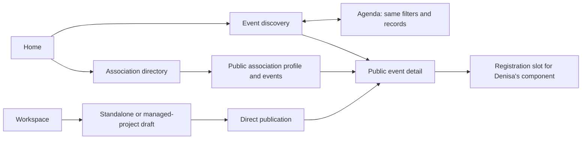

# Yasmine work package ? implementation and UX

Updated 16 November 2026. FR-10/FR-11 local implementation, based on the supplied
27-page team plan. Deadline: 18 November 2026, 16:00 Europe/Bucharest.

## What exists now

Gabriel's identities/workspaces/admin and Raul's projects/recruitment/reporting
are reused. Yasmine's slice adds event persistence, draft/edit/publish/cancel/complete,
organizer UI, public association presentation, combined listing, details and agenda.
Denisa's registration/attendance backend/UI and Tudor's messaging remain separate;
there is no duplicate implementation of either. See the actual API contract at
[events and public discovery](../contracts/events-and-public-discovery.md).

## Main screen flow



```text
Dedicated event discovery           Organizer workspace
[Brand] [Events] [Associations]     [Brand] [Workspace] [Public page]
[Association] [From UTC] [Through]  [Create event] [Refresh events]
[List | Agenda calendar]          Status / title / project / local event time
Date + timezone / title -> detail [Edit] [Publish] / [Cancel] / [Complete]
Association -> profile / location [Admin: public description + website]
[Previous] Page n [Next]
[Loading / empty / failure+retry]  Editor
                                  [Standalone / permitted project]
Public event                      [Title] [Description] [Location]
Status / title / association       [Start UTC] [End UTC] [Deadline UTC]
Schedule + named timezone         [IANA timezone] [Public start preview]
Location / full description       [Optional capacity] [Save] [Close]
Deadline / capacity
Registration availability notice
```

The homepage now contains introduction/navigation only; filters/list/agenda are
on the dedicated events page. These describe implemented screens, not user-validated
research. Actual owner feedback is recorded in [the review register](../ux/yasmine-review-register.md).
Real walkthrough observations remain empty:
record date/context, task, observed issue, FR ID, fix and retest outcome.

## Traceability

| Requirement | Implementation | Evidence |
| --- | --- | --- |
| FR-10 create/edit/publish | events package, EventWorkspace, V3 | standalone HTTP workflow; multiple project events; rejected managers, members and wrong association |
| FR-11 public profile | PublicAssociationController, profile editor, PublicAssociationsPage | exact safe DTO; anonymous reads; admin-only presentation writes; invalid website rejected |
| FR-11 discovery/calendar | PublicEventController, EventDiscovery, dedicated events page and association feeds | overlap/filter/page tests; frontend list/agenda/date/DST tests; desktop/mobile standalone/project browser scenarios |
| FR-03 isolation | AssociationAccess / ProjectAccess and scoped composite FK | private drafts, cross-project/cross-association/revoked-membership tests |
| FR-12 event fields | mandatory deadline, nullable capacity, stable public DTO | validation/extension tests; Denisa integration slot and documented lock protocol |

## Decisions and teammate review

Yasmine authorized full implementation without additional questions. Small local
defaults are documented in the event contract; they are not teammate approvals.
Raul must reconcile V3 allocation. Gabriel should review the profile editing split
(presentation fields here, name/slug/account/admin in his module). Denisa must
integrate her component and seat ledger using the documented status/time/lock rules.
No external messages were sent. No permission model, identity or reporting tree
was recreated to bypass these dependencies.

## Assessment and scope

All code/documents/tests in this slice are AI-assisted. Yasmine's independent
no-GenAI feature remains unassigned; no independent work is claimed. Gabriel's
research form is excluded. Yasmine still needs to review/explain the implementation,
conduct real usability checks and record actual human corrections.

No task, recruitment, messaging, attendance, QR, general site designer, custom
domain, attachment or external integration feature is included.

## Repository and verification

Initial branch main; feature branch creation is blocked by read-only .git.
Existing Frontend/package-lock.json edit is preserved. No commit/push/merge/deploy.
See [verification instructions](../testing-events.md), the engineering log and
[Yasmine's implementation guide](../../YASMINE_IMPLEMENTATION.md) for actual results
and remaining integration limitations.
